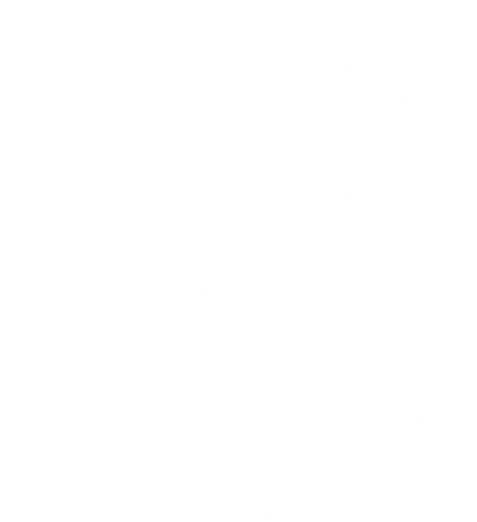

# OmniSport 🥊
### About
Backend API for a comprehensive ERP system for managing a martial arts club. Designed to provide full control over attendance, payments, and the club's community.
### Tech Stack
- Java 17
- Spring Boot 3.3
- PostgreSQL 15
- Flyway 10.15
- Hibernate
- Maven
- Docker
- GitHub Actions

### Features 
- JWT-based security (Spring Security)
- Result pagination
- Database migrations with Flyway
- DTO pattern implemented
- Relations between entities
- Authorization and login
- Global exception handler
- OpenAPI and UI using Swagger

### CI/CD Pipeline

The project uses **GitHub Actions** to automate testing and building processes:

* **Build & Test (Pull Requests):** Automatically provisions a PostgreSQL service container, sets up Java 17, and runs all Maven tests to ensure code quality before merging.
* **Package (Push to `main`):** Compiles the application and generates a production-ready `.jar` artifact.

### Testcontainers
The project uses **Testcontainers** for robust integration testing, ensuring zero-mock confidence.

### Getting Started & API Documentation

After running the application locally on port `8081`, interactive API documentation and testing tools are available out of the box:

* **Swagger UI:** `http://localhost:8081/swagger-ui/index.html`
* **OpenAPI Spec:** `http://localhost:8081/v3/api-docs`

> **Note on Authentication:** Secured endpoints require a JWT token. Obtain the token via `/api/auth/authenticate` and provide it in Swagger UI using the **Authorize** button (`Bearer <token>`).

### Manual Testing with Postman
If you prefer testing endpoints using Postman, you can directly import the JSON file `api/postman/OMNISPORT API.postman_collection.json`.

### Database Structure

